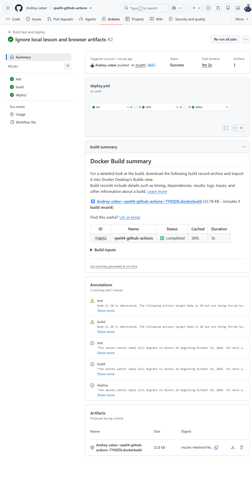
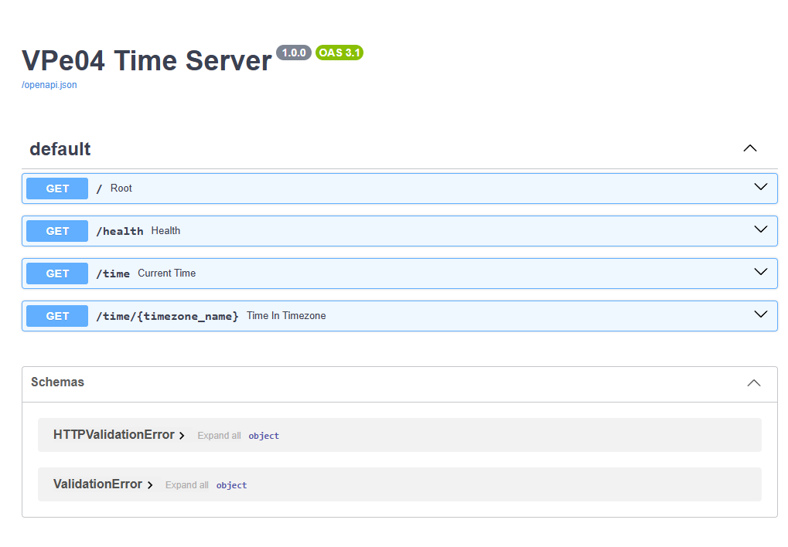

# Подробная инструкция по GitHub Actions, GHCR и автодеплою на VPS

## 1. Что было сделано

В рамках домашнего задания к уроку 34 был создан отдельный учебный проект `VPe04 Time Server` на FastAPI. Для проекта настроен полный процесс CI/CD с помощью GitHub Actions.

После каждого push в ветку `main` автоматически выполняется следующая цепочка:

1. GitHub Actions получает исходный код проекта.
2. Устанавливает Python и зависимости.
3. Запускает автоматические тесты.
4. Собирает Docker-образ приложения.
5. Публикует образ в GitHub Container Registry.
6. Подключается к VPS по SSH.
7. Загружает новый образ на сервер.
8. Останавливает и удаляет предыдущий контейнер приложения.
9. Запускает новую версию контейнера.
10. Проверяет endpoint `/health`.

Итоговая цепочка выглядит так:

```text
git push -> GitHub -> тесты -> Docker build -> GHCR -> SSH -> VPS -> healthcheck
```

Домашнее задание выполнено в расширенном варианте: кроме обязательной сборки и публикации Docker-образа реализован дополнительный автоматический деплой на VPS.

## 2. Требования домашнего задания

В уроке требовалось:

1. Создать простой проект на Flask или FastAPI.
2. Создать каталог `.github/workflows`.
3. Добавить файл `deploy.yml`.
4. Настроить запуск workflow при push в ветку `main`.
5. Выполнять сборку Docker-образа.
6. Публиковать образ в GitHub Container Registry.
7. По желанию добавить деплой на сервер через SSH Action.
8. Проверить успешное выполнение workflow во вкладке Actions.
9. Предоставить ссылку на репозиторий, скриншоты или архив проекта.

В выполненной работе реализованы все обязательные и дополнительные требования.

## 3. Использованная инфраструктура из урока 33

Для деплоя использован VPS, подготовленный в предыдущем задании:

- провайдер: REG.RU Облако;
- операционная система: Ubuntu 24.04 LTS;
- процессор: 4 vCPU;
- оперативная память: 6 ГБ;
- диск: 100 ГБ NVMe;
- публичный IP: `151.248.113.171`;
- SSH-пользователь: `root`;
- SSH-порт: `22`;
- короткое имя подключения: `reg-vpe03`;
- Docker: версия `29.9.0`;
- Coolify и приложение урока 33 продолжают работать независимо.

Для нового приложения выбран внешний порт `8001`. Благодаря этому контейнер домашнего задания не конфликтует с Coolify и приложением предыдущего урока.

## 4. Создание проекта FastAPI

### Шаг 1. Структура проекта

Создана следующая структура:

```text
vpe04-github-actions/
├── .github/
│   └── workflows/
│       └── deploy.yml
├── app/
│   ├── __init__.py
│   └── main.py
├── tests/
│   └── test_app.py
├── .dockerignore
├── .gitignore
├── Dockerfile
├── pyproject.toml
├── README.md
├── requirements.txt
└── requirements-dev.txt
```

### Шаг 2. Основные endpoint приложения

Приложение предоставляет следующие адреса:

- `GET /` — основная информация о сервисе;
- `GET /health` — проверка состояния приложения;
- `GET /time` — текущее время UTC;
- `GET /time/{timezone_name}` — текущее время в выбранной IANA-зоне;
- `GET /docs` — интерактивная документация Swagger UI.

Пример ответа `/health`:

```json
{"status":"healthy"}
```

Пример запроса времени по Москве:

```text
GET /time/Europe/Moscow
```

Если передана неизвестная временная зона, приложение возвращает HTTP `404` и понятное описание ошибки.

### Шаг 3. Зависимости приложения

В `requirements.txt` добавлены основные библиотеки:

```text
fastapi==0.119.0
uvicorn[standard]==0.37.0
tzdata==2025.2
```

В `requirements-dev.txt` добавлены инструменты тестирования:

```text
-r requirements.txt
httpx==0.28.1
pytest==8.4.2
```

Разделение зависимостей позволяет не устанавливать тестовые инструменты в production-контейнер.

## 5. Автоматические тесты

### Шаг 1. Создание тестов

В `tests/test_app.py` созданы три проверки:

1. `/health` возвращает HTTP `200` и статус `healthy`.
2. `/time` возвращает время в зоне UTC.
3. Неизвестная временная зона возвращает HTTP `404`.

### Шаг 2. Локальный запуск

Тесты запускались командой:

```powershell
uv run --no-project --python 3.13 --with-requirements requirements-dev.txt pytest -q
```

Фактический результат:

```text
3 passed
```

Тесты также выполняются автоматически в GitHub Actions до сборки образа. Если хотя бы один тест завершится ошибкой, job `build` не начнется.

## 6. Подготовка Docker-образа

### Шаг 1. Базовый образ

В Dockerfile используется официальный компактный образ:

```dockerfile
FROM python:3.13-slim
```

### Шаг 2. Установка зависимостей

Сначала копируется файл зависимостей, затем выполняется установка:

```dockerfile
COPY requirements.txt .
RUN pip install --no-cache-dir -r requirements.txt
```

Такой порядок позволяет Docker повторно использовать кэш слоя с зависимостями, если исходный код изменился, а `requirements.txt` остался прежним.

### Шаг 3. Запуск от непривилегированного пользователя

В образе создается отдельный системный пользователь:

```dockerfile
RUN addgroup --system app && adduser --system --ingroup app app
USER app
```

Приложение не запускается от имени `root` внутри контейнера. Это уменьшает последствия возможной уязвимости приложения.

### Шаг 4. Healthcheck

В Dockerfile добавлена встроенная проверка:

```dockerfile
HEALTHCHECK --interval=30s --timeout=5s --start-period=10s --retries=3 \
  CMD python -c "import urllib.request; urllib.request.urlopen('http://127.0.0.1:8000/health')"
```

Docker регулярно обращается к `/health`. Если приложение перестанет отвечать, состояние контейнера изменится с `healthy` на `unhealthy`.

### Шаг 5. Команда запуска

Приложение слушает все сетевые интерфейсы контейнера на порту `8000`:

```dockerfile
CMD ["uvicorn", "app.main:app", "--host", "0.0.0.0", "--port", "8000"]
```

## 7. Создание Git-репозитория

### Шаг 1. Локальная инициализация

Репозиторий создан командами:

```powershell
git init -b main
git add .
git commit -m "Add FastAPI service and GitHub Actions CI/CD"
```

Первый коммит:

```text
4d861cd Add FastAPI service and GitHub Actions CI/CD
```

### Шаг 2. Создание репозитория GitHub

Создан публичный репозиторий:

```text
https://github.com/Andrey-ceber/vpe04-github-actions
```

Основная ветка — `main`.

### Шаг 3. Публикация проекта

Локальная ветка была отправлена в GitHub. Push первого коммита автоматически запустил workflow.

Второй технический коммит исключил локальные материалы урока и служебные файлы Playwright из Git:

```text
82ddff3 Ignore local lesson and browser artifacts
```

После этого рабочее дерево Git осталось чистым.

## 8. Настройка GitHub Actions

Workflow находится по пути:

```text
.github/workflows/deploy.yml
```

Он называется `Build test and deploy`.

### Шаг 1. События запуска

Workflow запускается:

- при push в `main`;
- при pull request в `main`;
- вручную через `workflow_dispatch`.

Основная настройка:

```yaml
on:
  push:
    branches: [main]
  pull_request:
    branches: [main]
  workflow_dispatch:
```

Таким образом, обязательное требование запуска при push в `main` выполнено.

### Шаг 2. Разрешения workflow

Workflow получает минимально необходимые права:

```yaml
permissions:
  contents: read
  packages: write
```

Право `contents: read` нужно для получения кода, а `packages: write` — для публикации Docker-образа в GHCR.

### Шаг 3. Job test

Job `test` выполняет:

1. `actions/checkout@v4` — получает код репозитория.
2. `actions/setup-python@v5` — устанавливает Python 3.13.
3. Устанавливает зависимости из `requirements-dev.txt`.
4. Запускает `pytest -q`.

### Шаг 4. Job build

Job `build` содержит зависимость:

```yaml
needs: test
```

Поэтому Docker-образ собирается только после успешных тестов.

Основные действия job:

- `docker/setup-buildx-action@v3` — настраивает Docker Buildx;
- `docker/login-action@v3` — авторизуется в GHCR;
- `docker/build-push-action@v6` — собирает и публикует образ;
- GitHub Actions Cache ускоряет повторные сборки.

Имя образа формируется автоматически:

```text
ghcr.io/andrey-ceber/vpe04-github-actions:latest
```

Для pull request образ только собирается и проверяется. Публикация выполняется при push.

### Шаг 5. Job deploy

Job `deploy` зависит от успешного завершения сборки:

```yaml
needs: build
```

Она запускается только при push в ветку `main`:

```yaml
if: github.event_name == 'push' && github.ref == 'refs/heads/main'
```

Для SSH-подключения используется:

```yaml
uses: appleboy/ssh-action@v1.2.2
```

После подключения к VPS выполняются следующие операции:

1. Авторизация Docker в `ghcr.io`.
2. Загрузка свежего образа через `docker pull`.
3. Удаление предыдущего контейнера `vpe04-time-server`.
4. Запуск нового контейнера с политикой `--restart unless-stopped`.
5. Привязка внешнего порта `8001` к порту `8000` контейнера.
6. Несколько попыток обращения к `/health`.
7. Завершение job с ошибкой, если приложение не стало доступно.

## 9. Настройка GitHub Secrets

Для безопасного SSH-деплоя созданы repository secrets:

- `HOST` — IP-адрес VPS;
- `USERNAME` — SSH-пользователь;
- `PORT` — SSH-порт;
- `SSH_KEY` — приватный SSH-ключ.

Секреты используются так:

```yaml
host: ${{ secrets.HOST }}
username: ${{ secrets.USERNAME }}
key: ${{ secrets.SSH_KEY }}
port: ${{ secrets.PORT }}
```

Приватный ключ не добавлялся в репозиторий, README, отчет или логи. GitHub маскирует секретные значения при выполнении workflow.

Токен `GITHUB_TOKEN` создается GitHub автоматически на время запуска. Он используется для публикации образа и загрузки образа на VPS.

## 10. Первый запуск и исправление ошибки

### Ошибка missing server host

Первый workflow стартовал сразу после создания репозитория, до завершения добавления Secrets.

Тесты и сборка прошли успешно:

```text
test   Success
build  Success
deploy Failure
```

В deploy-логе появилась ошибка:

```text
Error: missing server host
```

Причина: в момент первого запуска значение `${{ secrets.HOST }}` еще отсутствовало.

### Решение

Были добавлены четыре Secrets: `HOST`, `USERNAME`, `PORT`, `SSH_KEY`. После этого выполнен повторный запуск только неудачной job:

```text
Re-run failed jobs
```

Повторный deploy завершился успешно за 16 секунд.

Этот пример показывает важное свойство GitHub Actions: повторно можно запускать только неудачные job, не выполняя заново уже успешные этапы.

## 11. Финальная проверка GitHub Actions

После заключительного push был запущен workflow №2:

```text
test    Success — 12s
build   Success — 24s
deploy  Success — 14s
```

Общий статус:

```text
Success
```

Ссылка на успешный запуск:

```text
https://github.com/Andrey-ceber/vpe04-github-actions/actions/runs/38302180044
```

Скриншот успешного workflow:



## 12. Проверка приложения на VPS

### Шаг 1. Проверка контейнера

После деплоя на сервере выполнена команда:

```bash
docker ps --filter name=vpe04-time-server
```

Фактическое состояние:

```text
vpe04-time-server | Up (healthy) | 0.0.0.0:8001->8000/tcp
```

Это означает:

- контейнер запущен;
- встроенный healthcheck проходит успешно;
- приложение доступно на внешнем порту `8001`;
- запросы направляются на порт `8000` внутри контейнера.

### Шаг 2. Проверка health endpoint на сервере

Команда:

```bash
curl -fsS http://127.0.0.1:8001/health
```

Ответ:

```json
{"status":"healthy"}
```

### Шаг 3. Проверка через Playwright

Через Playwright открыта Swagger UI:

```text
http://151.248.113.171:8001/docs
```

На странице отображаются четыре endpoint:

- `/`;
- `/health`;
- `/time`;
- `/time/{timezone_name}`.

Отдельно через браузер открыт endpoint:

```text
http://151.248.113.171:8001/health
```

Playwright подтвердил ответ:

```json
{"status":"healthy"}
```

Скриншот Swagger UI:



## 13. Как публиковать следующую версию

Для обновления приложения достаточно изменить код и выполнить:

```powershell
git add .
git commit -m "Краткое описание изменения"
git push
```

После push в `main` GitHub Actions автоматически:

1. проверит код тестами;
2. соберет новый Docker-образ;
3. обновит тег `latest` в GHCR;
4. подключится к VPS;
5. заменит контейнер;
6. проверит `/health`.

Ручной вход на VPS для обычного обновления не требуется.

## 14. Полезные команды диагностики

Проверить локальное состояние Git:

```powershell
git status --short
```

Посмотреть последние коммиты:

```powershell
git log --oneline -5
```

Запустить тесты локально:

```powershell
uv run --no-project --python 3.13 --with-requirements requirements-dev.txt pytest -q
```

Проверить запуски GitHub Actions:

```powershell
gh run list --repo Andrey-ceber/vpe04-github-actions
```

Посмотреть конкретный запуск:

```powershell
gh run view 38302180044 --repo Andrey-ceber/vpe04-github-actions
```

Посмотреть только ошибочные логи:

```powershell
gh run view НОМЕР_ЗАПУСКА --repo Andrey-ceber/vpe04-github-actions --log-failed
```

Подключиться к VPS:

```powershell
ssh reg-vpe03
```

Проверить контейнер:

```bash
docker ps --filter name=vpe04-time-server
```

Посмотреть последние 100 строк логов:

```bash
docker logs --tail 100 vpe04-time-server
```

Следить за логом в реальном времени:

```bash
docker logs -f vpe04-time-server
```

Проверить состояние приложения с VPS:

```bash
curl -fsS http://127.0.0.1:8001/health
```

Проверить внешний адрес:

```bash
curl -fsS http://151.248.113.171:8001/health
```

## 15. Возникшие сложности и их решение

### Локальный импорт приложения в pytest

При первом локальном запуске тестов появилась ошибка:

```text
ModuleNotFoundError: No module named 'app'
```

Для pytest был добавлен `pyproject.toml`:

```toml
[tool.pytest.ini_options]
pythonpath = ["."]
testpaths = ["tests"]
```

После этого все три теста прошли успешно.

### Первый deploy не увидел Secrets

Первый workflow стартовал раньше, чем были добавлены Secrets, поэтому SSH Action не получил адрес сервера. После добавления Secrets была повторно запущена только job `deploy`, и она завершилась успешно.

### Отдельная сессия Playwright сначала не была авторизована

GitHub CLI был авторизован, но Playwright использовал отдельную браузерную сессию. После входа в GitHub через браузер стали доступны подробные страницы запусков. Публичные страницы репозитория и работающего приложения при этом проверялись и без авторизации.

### Защита приложения предыдущего урока

На VPS уже работали Coolify и сервис генерации PDF-квитанций. Чтобы не изменять их конфигурацию, новый контейнер опубликован на отдельном порту `8001`. Существующие контейнеры не останавливались и не удалялись.

## 16. Правила безопасности

1. Никогда не добавлять приватный SSH-ключ в Git.
2. Не вставлять токены и пароли в `deploy.yml`.
3. Хранить SSH-параметры в GitHub Secrets.
4. Не выводить содержимое секретов в лог workflow.
5. Выдавать workflow только необходимые разрешения.
6. Запускать приложение внутри контейнера от непривилегированного пользователя.
7. Использовать автоматические тесты до публикации образа.
8. Выполнять healthcheck после каждого деплоя.
9. Не удалять чужие контейнеры или данные на общем VPS.
10. Для production рекомендуется отказаться от ежедневной работы под `root`, настроить firewall, HTTPS, отдельного deploy-пользователя и резервное копирование.

## 17. Что приложить к домашнему заданию

Для сдачи подготовлены:

1. Ссылка на публичный репозиторий:

   ```text
   https://github.com/Andrey-ceber/vpe04-github-actions
   ```

2. Ссылка на успешный workflow:

   ```text
   https://github.com/Andrey-ceber/vpe04-github-actions/actions/runs/38302180044
   ```

3. Скриншот успешного выполнения `test`, `build`, `deploy`:

   ```text
   screenshots/actions-success.png
   ```

4. Скриншот работающего приложения:

   ```text
   screenshots/app-swagger.png
   ```

5. Адрес приложения:

   ```text
   http://151.248.113.171:8001/docs
   ```

6. Health endpoint:

   ```text
   http://151.248.113.171:8001/health
   ```

## 18. Готовый текст для отправки в чат курса

Выполнил домашнее задание к уроку 34 по GitHub Actions. Создал FastAPI-приложение, которое возвращает текущее время UTC и время в выбранной часовой зоне. Добавил health endpoint и автоматические тесты.

Создал workflow `.github/workflows/deploy.yml`, который запускается при push в ветку `main`. Workflow последовательно выполняет тесты, собирает Docker-образ и публикует его в GitHub Container Registry. Также выполнил дополнительную часть задания: добавил автоматический деплой на VPS через SSH Action.

Параметры подключения хранятся в GitHub Secrets: `HOST`, `USERNAME`, `SSH_KEY`, `PORT`. Приватный ключ в репозиторий не добавлялся.

Финальный запуск GitHub Actions завершился успешно: job `test`, `build` и `deploy` имеют статус Success. После деплоя контейнер на VPS работает со статусом `healthy`, а endpoint `/health` возвращает HTTP 200 и `{"status":"healthy"}`.

Репозиторий:

```text
https://github.com/Andrey-ceber/vpe04-github-actions
```

Успешный workflow:

```text
https://github.com/Andrey-ceber/vpe04-github-actions/actions/runs/38302180044
```

Работающее приложение:

```text
http://151.248.113.171:8001/docs
```

Основная возникшая сложность: первый deploy запустился до добавления GitHub Secrets и завершился ошибкой `missing server host`. После добавления Secrets повторный запуск deploy прошел успешно.

## 19. Итоговое состояние

На момент контрольной проверки:

- репозиторий публичный;
- основная ветка — `main`;
- локальные тесты — `3 passed`;
- GitHub Actions — `Success`;
- job `test` — `Success`;
- job `build` — `Success`;
- job `deploy` — `Success`;
- образ опубликован в GHCR;
- контейнер `vpe04-time-server` — `healthy`;
- порт приложения — `8001`;
- `/health` — HTTP `200`;
- Swagger UI доступна с внешнего адреса;
- рабочее дерево Git не содержит незакоммиченных файлов проекта.
